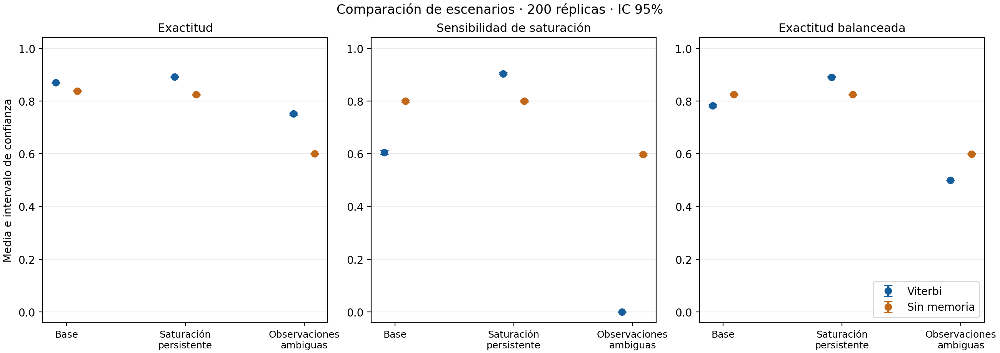
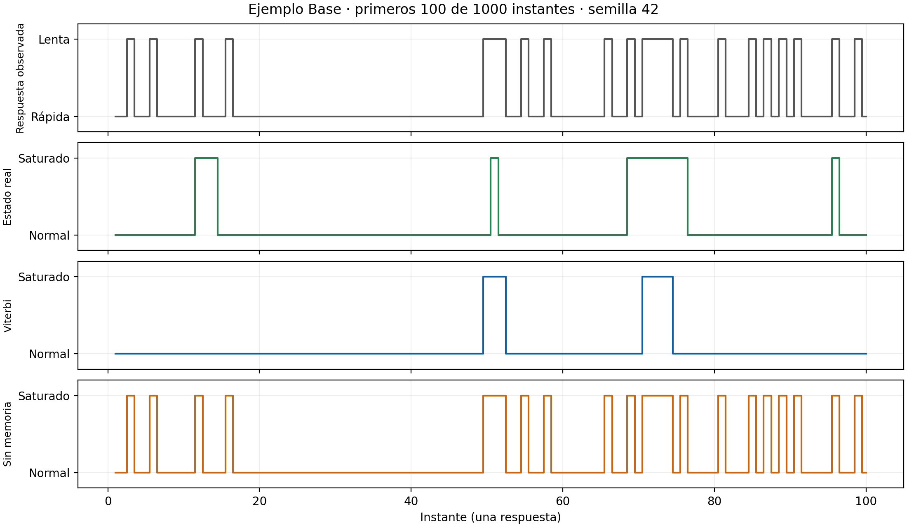

# Resultados e interpretación

## Experimento realizado

Se ejecutaron los tres escenarios del diseño: 200 réplicas de 1000 respuestas por escenario, semilla maestra 20261108 y flujos hijos distintos. En cada réplica se compararon Viterbi y la regla sin memoria sobre las mismas observaciones. No se ajustaron parámetros después de observar los resultados.

Los datos están en [metricas_replicas.csv](../resultados/metricas_replicas.csv), las estadísticas completas en [resumen.csv](../resultados/resumen.csv), y la tabla legible en [resumen.md](../resultados/resumen.md). Se reportan n, media, desviación estándar muestral, mínimo, máximo e IC t del 95 % de la media entre réplicas.

## Comparación principal

| Escenario | Exactitud Viterbi | Exactitud sin memoria | Sensibilidad Viterbi | Sensibilidad sin memoria | Exactitud balanceada Viterbi / sin memoria |
|---|---:|---:|---:|---:|---:|
| Base | 86.95 % | 83.76 % | 60.51 % | 79.94 % | 78.24 % / 82.50 % |
| Saturación persistente | 89.16 % | 82.50 % | 90.36 % | 79.94 % | 89.07 % / 82.50 % |
| Observaciones ambiguas | 75.11 % | 60.01 % | 0.00 % | 59.75 % | 50.00 % / 59.92 % |

Son medias entre réplicas redondeadas a dos decimales. Los intervalos y la dispersión de cada métrica se conservan en el CSV; no deben deducirse de los valores redondeados de esta tabla.

### Escenario base

Viterbi alcanzó una exactitud media de 86.95 %, con IC del 95 % de 86.73–87.17 %. La diferencia emparejada frente a la regla simple fue de **3.19 puntos porcentuales**, IC 2.99–3.39. El intervalo de la diferencia queda por encima de cero bajo este protocolo.

Sin embargo, la sensibilidad de saturación fue menor: 60.51 % frente a 79.94 %. La exactitud balanceada también fue menor. Una mejora en exactitud global no equivale a una mejora en todas las métricas ni garantiza una mejor detección de saturación.

### Saturación persistente

Viterbi obtuvo exactitud media de 89.16 %, IC 88.92–89.41 %, y sensibilidad de 90.36 %. La diferencia emparejada de exactitud fue de **6.67 puntos**, IC 6.45–6.88. En este escenario mejora también la exactitud balanceada respecto de la comparación sin memoria.

La modificación de A aumenta tanto la persistencia como la frecuencia de saturación. Estos resultados describen el efecto conjunto del cambio y no permiten atribuir la mejora únicamente a la duración de las rachas.

### Observaciones ambiguas

Viterbi alcanzó 75.11 % de exactitud, IC 74.73–75.49 %, pero su sensibilidad de saturación fue **cero en las 200 réplicas**: todas sus predicciones fueron normales. Su exactitud balanceada quedó en 50 %. La regla sin memoria obtuvo menor exactitud global, pero recuperó parte de los estados saturados.

La diferencia emparejada de exactitud fue de 15.11 puntos, IC 14.67–15.54. Ese incremento no representa una mejora útil para detectar saturación: refleja una trayectoria favorecida por las transiciones y la debilidad de las emisiones, en un escenario donde predominan los estados normales. Viterbi maximiza la probabilidad de la secuencia conjunta, no la sensibilidad ni la exactitud por instante.

## Ejemplo temporal

La figura presenta los primeros 100 instantes de la secuencia base ilustrativa de 1000 respuestas, con semilla 42. La decodificación usó las 1000 observaciones completas antes de recortar la visualización. El CSV [ejemplo_trayectoria.csv](../resultados/ejemplo_trayectoria.csv) conserva la secuencia completa. Este ejemplo está separado de las 600 réplicas experimentales.

## Respuestas a las preguntas del estudio

- **P1, representación:** estados internos y respuestas se relacionan probabilísticamente mediante π, A y B; las emisiones permiten respuestas ambiguas bajo un mismo estado.
- **P2, parámetros:** cambiar A o acercar las distribuciones de B modifica las métricas de recuperación. El desempeño depende de la métrica elegida; no se observó superioridad uniforme de Viterbi.
- **P3, reproducibilidad y sensibilidad:** se conservaron configuración, semillas, versiones y resultados por réplica. Las variantes de A y B constituyen el análisis controlado de sensibilidad a parámetros; no representan una exploración exhaustiva del espacio del modelo.

## Límites y conclusiones del experimento

El HMM representa el caso didáctico y permite estudiar los efectos de la dependencia temporal y de las emisiones. Bajo saturación persistente, Viterbi presentó mejoras en las tres métricas principales. En los otros dos escenarios, su mayor exactitud global coexistió con menor sensibilidad y menor exactitud balanceada. Una aplicación orientada a alertas necesitaría definir costos de falsas alarmas y omisiones, y evaluar métodos adecuados a ese objetivo.

Estos resultados usan datos sintéticos, matrices conocidas, dos estados, dos categorías y una longitud fija. No incluyen entrenamiento, parámetros mal especificados, mediciones reales ni detección en tiempo real. Los IC aproximan la incertidumbre Montecarlo de las medias bajo el diseño fijado; no incluyen incertidumbre sobre los parámetros del servidor. Tampoco son intervalos de predicción de una nueva secuencia ni establecen superioridad universal de un método.

Como trabajo futuro pueden explorarse inferencia marginal, costos de clasificación, otras longitudes, errores en los parámetros y datos reales con etiquetas verificables. Ninguna de esas extensiones se presenta como implementada.